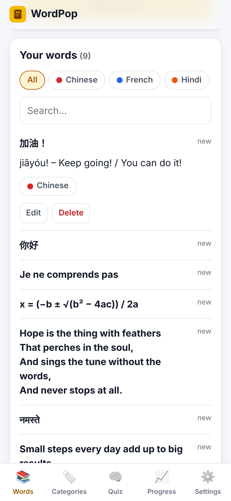
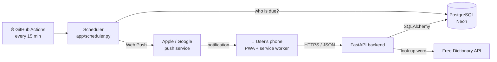
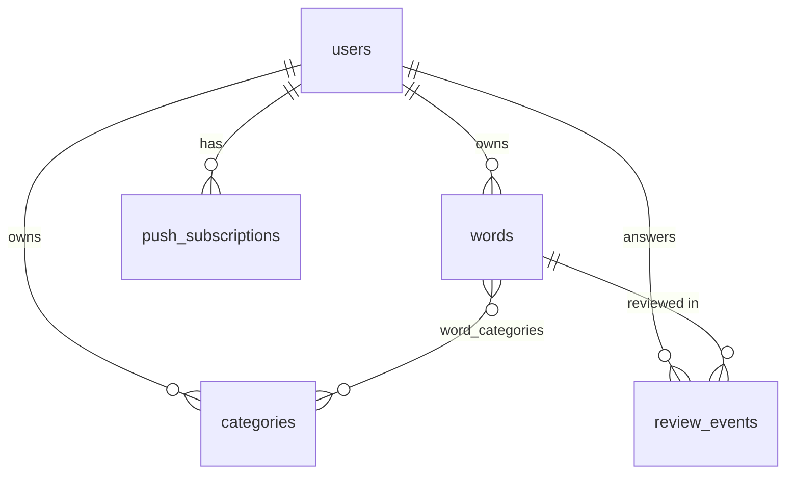

# WordPop 📘

**Save new English words and get them as reminders on your phone until you know them.**

WordPop is an installable web app (PWA) for English learners. Add a word – the meaning, example and
pronunciation are filled in automatically – and WordPop sends it back to you as a push notification
at the times you choose. A built-in quiz with spaced repetition brings back the words you forget
and spaces out the ones you know.


**Live demo:** _coming soon_

| Words | Quiz | Progress | Settings |
|---|---|---|---|
|  |  |  |  |

## Features

- **User accounts** – email + password, hashed with bcrypt; sessions in secure HTTP-only cookies
- **Forgot password** – one-time, 1-hour email link (only a hash is stored); resetting signs out all other devices; rate-limited
- **Auto-filled words** – type a word, get its definition, example, phonetic spelling and audio
- **Categories** – a word can belong to several categories (e.g. *IELTS* and *Work*)
- **Per-category notifications** – switch reminders on or off for each category
- **Notification schedule per user** – how often, active hours, active days, daily limit, pause for a few hours / a day / a week
- **Time-zone aware** – every user gets reminders in their own local hours
- **Quiz mode** – optional notifications that hide the meaning so you try to recall it first
- **Spaced repetition** – a Leitner-box system schedules each word's next review
- **Progress page** – streak, mastered words, accuracy, 7-day activity and hardest words
- **Starter word lists** – IELTS, Business English, Phrasal Verbs and Idioms for a useful first day
- **iPhone install guide** – walks users through *Add to Home Screen*, which iOS requires for web push
- **Admin analytics** – sign-ups, weekly active users and day-1/7/28 retention
- **Privacy** – users can delete their account and all data in one tap

## Tech stack

| Layer | Technology |
|---|---|
| Backend | Python 3.12, FastAPI, SQLAlchemy 2, Pydantic |
| Database | PostgreSQL (Neon serverless, free tier); SQLite for local dev and tests |
| Frontend | Progressive Web App – vanilla JavaScript, service worker, Web App Manifest |
| Notifications | Web Push (VAPID) via `pywebpush` |
| Email | SMTP (Gmail App Password or any provider) for password resets |
| Scheduling | GitHub Actions cron (every 15 min) running `python -m app.scheduler` |
| Quality | pytest, ruff, GitHub Actions CI |
| Packaging | Docker, docker compose |

## Architecture



**How a reminder is chosen.** Every 15 minutes the scheduler checks each user with notifications on:
is the user paused? Is it one of their active days and hours *in their time zone*? Has enough time
passed since the last reminder, and are they under their daily limit? If so, it picks the most
overdue word from a category with notifications switched on and sends it to all of the user's devices.
Push subscriptions that the push service reports as expired are cleaned up automatically.

### Database



## Run it locally

You need Python 3.12+.

```bash
git clone https://github.com/Ramvam63/wordpop.git
cd wordpop
cp .env.example .env                 # then edit the values
python scripts/generate_vapid_keys.py   # paste the two lines into .env
cd backend
pip install -r requirements-dev.txt
uvicorn app.main:app --reload        # open http://localhost:8000
```

Leave `DATABASE_URL` empty in `.env` to use a local SQLite file, or point it at PostgreSQL.

**With Docker** (includes a PostgreSQL container):

```bash
docker compose up --build                     # app only
docker compose --profile push up --build      # app + notification scheduler
```

**Tests and lint:**

```bash
cd backend
pytest -q
ruff check .
```

## Deploy

1. **Database** – create a free project on [Neon](https://neon.com) and copy its connection string.
2. **Web app** – deploy the `Dockerfile` to any host that runs containers, and set the variables from
   `.env.example`. Use a long random `SECRET_KEY` and your real `https://` address as `APP_URL`
   (web push and secure cookies need HTTPS).
3. **Notifications** – in GitHub, go to *Settings → Secrets and variables → Actions* and add
   `DATABASE_URL`, `VAPID_PUBLIC_KEY`, `VAPID_PRIVATE_KEY` and `VAPID_SUBJECT`. The
   *Send notifications* workflow then runs every 15 minutes.

> GitHub may delay scheduled workflows during busy periods, and pauses them in repositories with no
> activity for a long time. For exact timing, run `python -m app.scheduler --loop` on a server instead.

## API

The interactive API documentation is available at `/docs` when the server is running.

| Area | Endpoints |
|---|---|
| Auth | `POST /api/auth/signup` · `POST /api/auth/login` · `POST /api/auth/logout` · `GET/DELETE /api/auth/me` · `POST /api/auth/forgot-password` · `POST /api/auth/reset-password` |
| Words | `GET/POST /api/words` · `PATCH/DELETE /api/words/{id}` · `GET /api/dictionary/{word}` |
| Categories | `GET/POST /api/categories` · `PATCH/DELETE /api/categories/{id}` |
| Quiz | `GET /api/quiz/next` · `POST /api/quiz/answer` |
| Settings & progress | `GET/PUT /api/me/settings` · `POST /api/me/pause` · `GET /api/me/progress` |
| Push | `GET /api/push/public-key` · `POST /api/push/subscribe` · `POST /api/push/unsubscribe` · `POST /api/push/test` |
| Starter lists | `GET /api/starter-lists` · `POST /api/starter-lists/{key}/import` |
| Admin | `GET /api/admin/stats` |

## Project structure

```
wordpop/
├── backend/
│   ├── app/
│   │   ├── main.py            # FastAPI app, serves the API and the PWA
│   │   ├── models.py          # database tables
│   │   ├── routers/           # API endpoints by area
│   │   ├── scheduler.py       # sends due notifications
│   │   ├── notifications.py   # schedule rules + Web Push delivery
│   │   ├── srs.py             # spaced repetition
│   │   ├── dictionary.py      # auto-fill from the Dictionary API
│   │   └── data/starter_lists.json
│   └── tests/
├── frontend/                  # the PWA: index.html, app.js, sw.js, manifest, icons
├── scripts/                   # VAPID keys, icons, GitHub issues
├── docs/                      # screenshots, roadmap
├── .github/workflows/         # CI + notification schedule
├── Dockerfile
└── docker-compose.yml
```

## Roadmap

- [x] v1 – personal script: SQLite + ntfy notifications
- [x] v2 – multi-user PWA: accounts, categories, schedules, quiz, progress, web push
- [x] Forgot password by email
- [ ] Sign in with Google / magic-link email
- [ ] Translations into the learner's own language
- [ ] Database migrations with Alembic
- [ ] Import / export words as CSV
- [ ] Native iOS app (Swift) using the same API

See [docs/ROADMAP.md](docs/ROADMAP.md) for details.

## Privacy

WordPop stores only what it needs: email, hashed password, your words and settings, quiz answers and
push addresses. No ads, no selling of data. See [frontend/privacy.html](frontend/privacy.html).

## License

[MIT](LICENSE)
