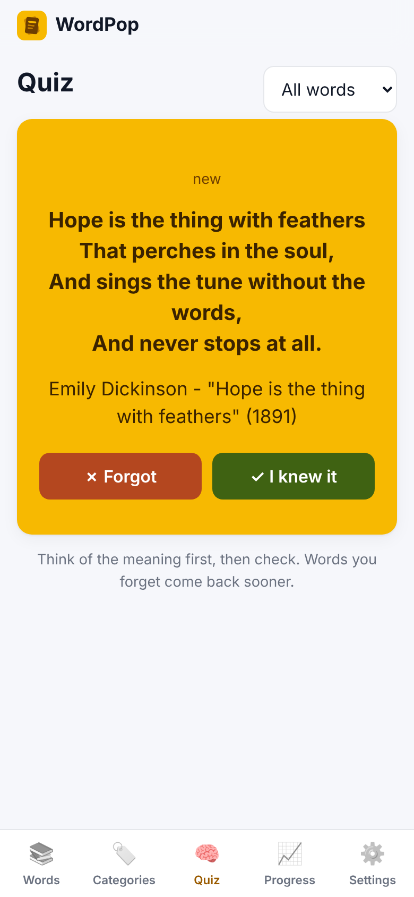
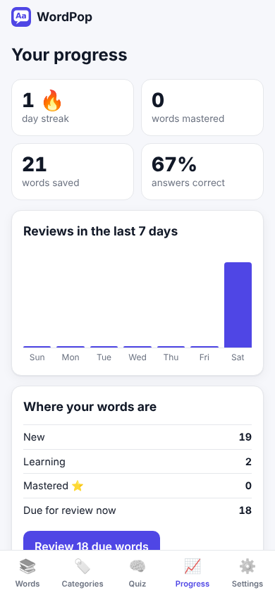
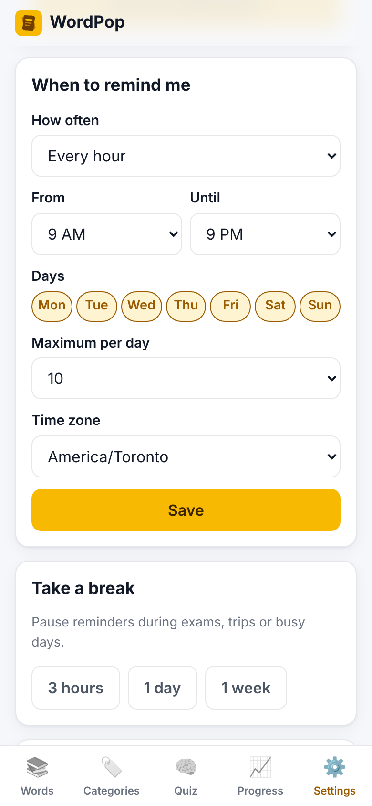
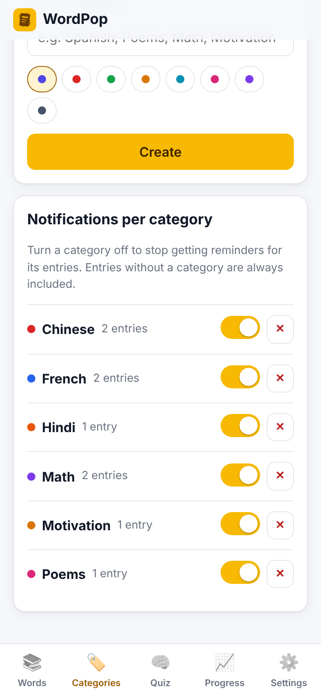
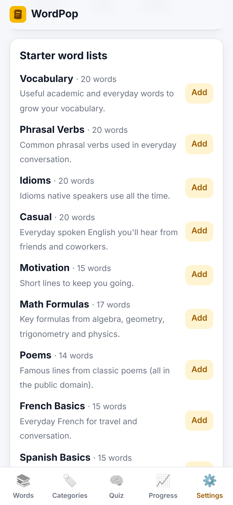
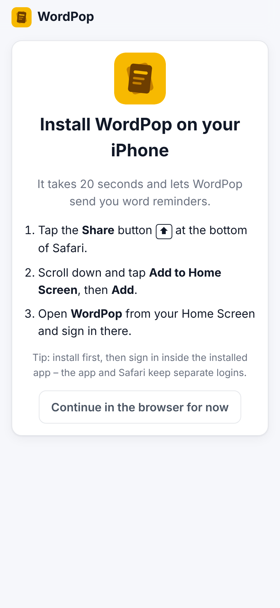
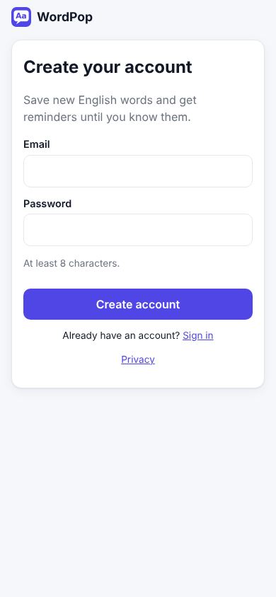
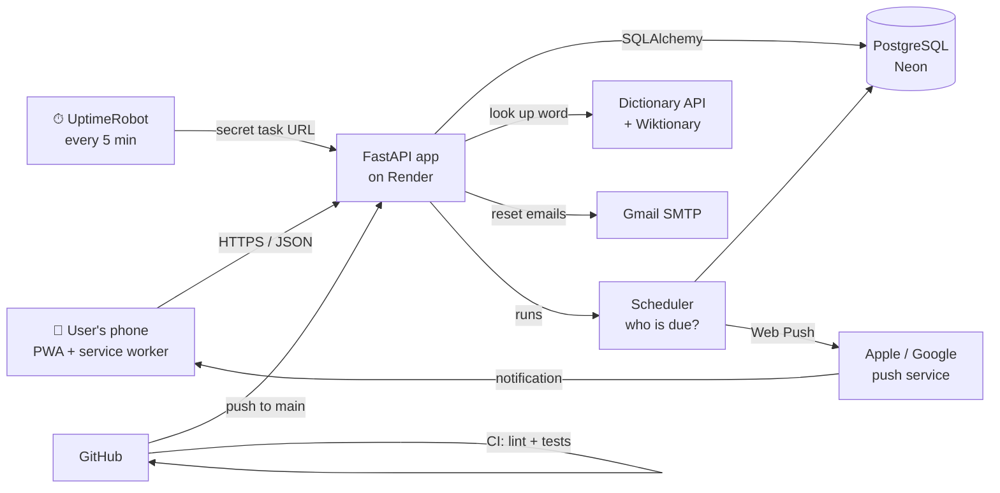
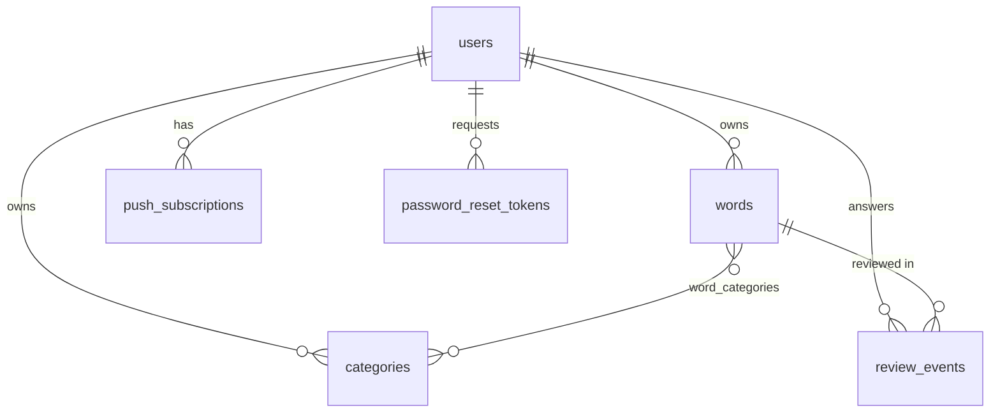

<p align="center">
  
</p>

<h1 align="center">WordPop</h1>

<p align="center">
  <b>Pop anything you want to remember onto your phone – until you know it by heart.</b><br/>
  Words in any language · phrases · sentences · quotes · poems · motivational lines · math formulas · facts
</p>

<p align="center">
  <a href="https://wordpopapp.onrender.com"></a>
</p>

<p align="center">
  <a href="https://github.com/Ramvam63/wordpop/actions/workflows/ci.yml"></a>
  
  
  
  
  
</p>

---

## Try it – free, no download from an app store

<table>
<tr>
<td width="62%">

**On iPhone** (Safari)
1. Open **[wordpopapp.onrender.com](https://wordpopapp.onrender.com)** in **Safari**
2. Tap **Share ⬆ → Add to Home Screen → Add**
3. Open **WordPop** from your Home Screen and create an account
4. Go to **Settings → Turn on notifications**

**On Android** (Chrome): open the link and tap **Install**.

**On a computer**: just open the link in any browser.

</td>
<td align="center">

<br/>
<sub>Scan with your phone camera</sub>

</td>
</tr>
</table>

## What can you remember with WordPop?

WordPop isn't only for vocabulary. Save **any short text** – up to 500 characters, with line breaks – and
WordPop shows it to you on your phone at the times you choose, then quizzes you until it sticks.

| Use it for | Example entry | Meaning / note |
|---|---|---|
| 🗣 **Words in any language** | *resilient* · *bonjour* · *你好 (nǐ hǎo)* · *नमस्ते (namaste)* | the meaning in your own language |
| 💬 **Phrases & idioms** | *break the ice* · *¿Qué tal?* · *加油！(jiāyóu)* | when and how to use it |
| ✍️ **Sentences** | *Could you say that again, please?* | a polite way to ask someone to repeat |
| 📜 **Poems & verses** | a few lines of your favourite poem | the poet, or what it means to you |
| 🔥 **Motivation & quotes** | *Small steps every day.* | who said it, or why it matters |
| ➗ **Math & science formulas** | *a² + b² = c²* · *E = mc²* · *sin²x + cos²x = 1* | what each symbol means |
| 🧠 **Anything else** | dates, definitions, exam facts, favourite verses, keyboard shortcuts… | a short explanation |

- **Any language and script** – Chinese, Hindi, French, Spanish, Japanese, Arabic… Right-to-left text displays correctly too.
- **Categories** keep each kind apart (e.g. *French*, *Chinese*, *Poems*, *Math*, *Motivation*), and you choose which ones send reminders.
- **Share to WordPop** – select text in any app, tap Share → WordPop and it opens ready to save (Android, Chrome/Edge on computers; an iPhone Shortcut does the same)
- **CSV import & export** – back up your entries or add hundreds at once from Excel, Google Sheets or Numbers (UTF-8 and older Excel files, commas, semicolons or tabs; duplicates skipped)
- **Automatic meanings** are available for English words and phrases; for everything else you write your own meaning or note.

## Screenshots

| Words | Quiz | Progress | Settings |
|---|---|---|---|
|  |  |  |  |

| Categories | Starter lists | iPhone install guide | Sign up |
|---|---|---|---|
|  |  |  |  |

## Features

- **Reminders on your phone** – each notification shows only your entry, so you try to recall the meaning; tap it to check
- **Any language, any text** – words, phrases, sentences, quotes, poems and formulas up to 500 characters, with line breaks and right-to-left support
- **Auto-filled English entries** – type an English word or phrase, get its meaning, an example, pronunciation and audio
- **Natural voices** – Clara and Liam (Canadian), Ava and Andrew (American) read entries and examples on every device (Azure AI Speech, each recording made once and stored)
- **Listen to every entry, pronunciation for words** – the phone's own voice reads any entry in its language; single English words get an IPA line and Chinese words get pinyin, worked out offline
- **Categories** – an entry can belong to several; switch reminders on or off per category, plus a **No category** switch for entries you haven't filed
- **Rotating reminders** – every due entry gets its turn; nothing repeats until the others have been shown
- **Your own schedule** – how often, active hours, active days, daily limit, pause for 3 hours / a day / a week, and your own time zone
- **Spaced-repetition quiz** – words you forget come back sooner; words you know are spaced out
- **Progress page** – streak, mastered words, accuracy, 7-day activity and hardest words
- **10 ready-made categories** added with one tap – English (Vocabulary, Phrasal Verbs, Idioms, Casual), Motivation, Math Formulas, Poems, and French, Chinese and Hindi basics. They start empty: everyone builds their list from their own words
- **Installable app (PWA)** – Home Screen icon, opens instantly from cache, step-by-step iPhone install guide
- **Accounts & security** – bcrypt-hashed passwords, HTTP-only session cookies, **forgot-password emails** with one-time links (stored hashed, rate-limited), reset signs out other devices
- **Privacy** – delete your account and all data in one tap
- **Admin analytics** – sign-ups, weekly active users and day-1/7/28 retention

## Tech stack

| Area | Technology | Why |
|---|---|---|
| Backend | **Python 3.12, FastAPI**, SQLAlchemy 2, Pydantic | Fast, typed REST API with automatic docs at `/docs` |
| Database | **PostgreSQL on [Neon](https://neon.com)** (serverless, free tier); SQLite for tests | Real relational database with a many-to-many words ↔ categories model |
| Frontend | **Progressive Web App** – vanilla JavaScript, service worker, Web App Manifest | Installs on iPhone/Android without an app store; no build step |
| Notifications | **Web Push** with VAPID keys (`pywebpush`) | Native-looking reminders on iPhone (iOS 16.4+), Android and desktop |
| Hosting | **[Render](https://render.com)** (Docker web service) | Deploys automatically on every `git push` to `main` |
| Scheduling & uptime | **[UptimeRobot](https://uptimerobot.com)** calls a secret task URL every 5 minutes | Sends due reminders on time and keeps the free server awake |
| Email | **SMTP** (Gmail App Password) | Password-reset emails |
| English look-up | **Free Dictionary API** + **Wiktionary** fallback | Auto-fills definitions, examples, phonetics and audio for English words and idioms |
| Quality | **pytest** (37 tests), **ruff**, **GitHub Actions CI** | Every push is linted and tested automatically |
| Packaging | **Docker**, docker compose | Same container locally and in production |

## Architecture



**How a reminder is chosen.** Every 5 minutes UptimeRobot calls `/api/tasks/send-notifications?key=…`.
For each user with notifications on, the scheduler checks: paused? one of their active days and hours
*in their own time zone*? enough time since the last reminder, and under the daily limit? If so it picks
the most overdue word from a category with reminders switched on and sends it to all of the user's
devices. Expired push subscriptions are cleaned up automatically, and one failing device never stops
the run for everyone else.

### Database



## Run it locally

You need Python 3.12+.

```bash
git clone https://github.com/Ramvam63/wordpop.git
cd wordpop
cp .env.example .env                    # then edit the values
python scripts/generate_vapid_keys.py   # paste the two lines into .env
cd backend
pip install -r requirements-dev.txt
uvicorn app.main:app --reload           # open http://localhost:8000
```

Leave `DATABASE_URL` empty to use a local SQLite file. Without SMTP settings, password-reset links are
printed in the terminal instead of emailed.

**With Docker** (includes a PostgreSQL container):

```bash
docker compose up --build
```

**Tests and lint:**

```bash
cd backend
pytest -q
ruff check .
```

## Deploy (all free tiers)

1. **Database** – create a project on [Neon](https://neon.com) and copy its connection string.
2. **Web app** – create a Docker **Web Service** on [Render](https://render.com) from this repository and add
   the variables from `.env.example` (use your real `https://` address as `APP_URL`, a long random
   `SECRET_KEY` and a random `CRON_SECRET`).
3. **Reminders** – create an HTTP(s) monitor on [UptimeRobot](https://uptimerobot.com) for
   `https://YOUR-APP.onrender.com/api/tasks/send-notifications?key=YOUR_CRON_SECRET` with a 5-minute interval.
4. **Email** (optional) – add a Gmail App Password as `SMTP_PASSWORD` to enable "Forgot password?" emails.
5. **Natural voices** (optional) – create a free (F0) **Speech service** in the [Azure portal](https://portal.azure.com)
   and add its key and region as `AZURE_SPEECH_KEY` and `AZURE_SPEECH_REGION`. Without them the app uses the phone's voices.

> The *Send notifications* GitHub Actions workflow is an optional backup scheduler; it is disabled when
> UptimeRobot is used, so reminders are never sent twice.

## API

Interactive documentation: **[wordpopapp.onrender.com/docs](https://wordpopapp.onrender.com/docs)**

| Area | Endpoints |
|---|---|
| Auth | `POST /api/auth/signup` · `login` · `logout` · `forgot-password` · `reset-password` · `GET/DELETE /api/auth/me` |
| Words | `GET/POST /api/words` · `PATCH/DELETE /api/words/{id}` · `POST /api/words/delete-many` · `GET /api/words/export` (CSV) · `POST /api/words/import` · `GET /api/dictionary/{word}` |
| Categories | `GET/POST /api/categories` · `PATCH/DELETE /api/categories/{id}` |
| Quiz | `GET /api/quiz/next` · `POST /api/quiz/answer` |
| Settings & progress | `GET/PUT /api/me/settings` · `POST /api/me/pause` · `GET /api/me/progress` |
| Voices | `GET /api/tts/voices` · `GET /api/tts?text=…&voice=ca-female` (MP3, cached) |
| Push | `GET /api/push/public-key` · `POST /api/push/subscribe` · `unsubscribe` · `test` |
| Starter lists | `GET /api/starter-lists` · `POST /api/starter-lists/{key}/import` |
| Tasks | `GET /api/tasks/send-notifications?key=…` (called by UptimeRobot) |
| Admin | `GET /api/admin/stats` |

## Project structure

```
wordpop/
├── backend/
│   ├── app/
│   │   ├── main.py            # FastAPI app: serves the API and the PWA
│   │   ├── models.py          # database tables
│   │   ├── routers/           # API endpoints by area (auth, words, quiz, tasks, …)
│   │   ├── scheduler.py       # decides who gets a reminder and sends it
│   │   ├── notifications.py   # schedule rules + Web Push delivery
│   │   ├── srs.py             # spaced repetition (Leitner boxes)
│   │   ├── dictionary.py      # Dictionary API + Wiktionary look-ups
│   │   ├── mailer.py          # password-reset emails
│   │   └── data/starter_lists.json
│   └── tests/                 # 37 pytest tests
├── frontend/                  # the PWA: index.html, app.js, sw.js, styles.css, icons
├── scripts/                   # VAPID keys, icons, QR code, GitHub issues
├── docs/                      # screenshots, QR code, roadmap
├── .github/workflows/         # CI (lint + tests) and backup scheduler
├── Dockerfile
└── docker-compose.yml
```

## Roadmap

- [x] v1 – personal script: SQLite + ntfy notifications
- [x] v2 – multi-user PWA: accounts, categories, schedules, quiz, progress, web push
- [x] Forgot password by email
- [x] Amber design, reliable 5-minute reminders, instant start
- [ ] Sign in with Google / magic-link email
- [x] Any language and any short text (sentences, quotes, poems, formulas)
- [ ] Look-up and translation for more languages
- [ ] Nicely typeset math formulas (LaTeX)
- [ ] Database migrations with Alembic
- [x] Import / export words as CSV
- [ ] Native iOS app (Swift) using the same API

See [docs/ROADMAP.md](docs/ROADMAP.md) for details.

## Privacy

WordPop stores only what it needs: email, hashed password, your words and settings, quiz answers and
push addresses. No ads, no selling of data. See the [privacy page](https://wordpopapp.onrender.com/privacy.html).

## License

[MIT](LICENSE) © 2026 Hamed Ghorbanian
